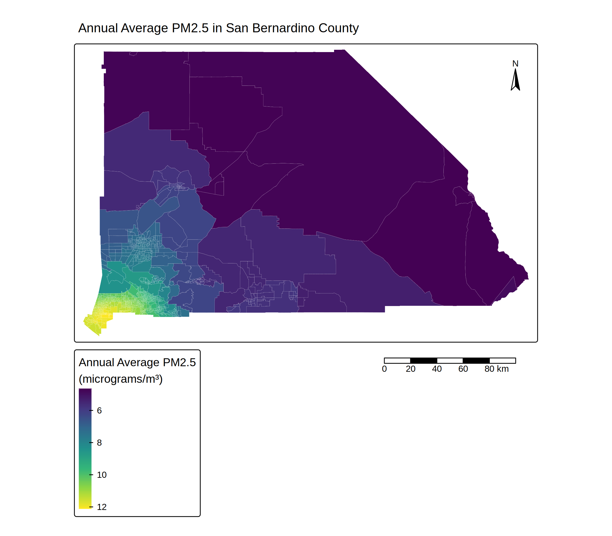
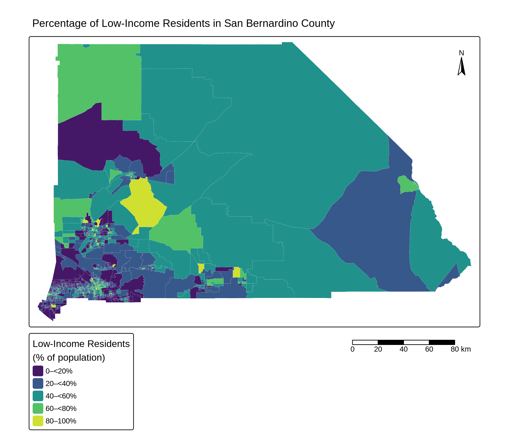

# EDS223 Homework 1 Repository - Map Making Practice 

# Repository Purpose 
- This reposiory contains the first homework assignment for EDS223: Geospatial Analysis and Remote Sensing, where we are tasked with creating two maps analyzing environmental justice concerns in a region of our choice. For this homework, I am looking at PM2.5 and income disparities in San bernadino County, Califonia. 

## Maps Created 

### Map 1 - Annual-average PM2.5 concentrations.

### Map 2 - Percentage of low-income residents

## Data Availability 
 - The EJSCReen 2023 dataset sourced from the Environmental Protection Agency (EPA) was used for this assignment. This dataset is no longer available for download on the EPA website.

 ## Contributers 
 Author: Kate Frankland 
 Instructor: Annie Adams 

 ## References 
 U.S. Environmental Protection Agency (EPA), 2023. EJScreen Technical Documentation  